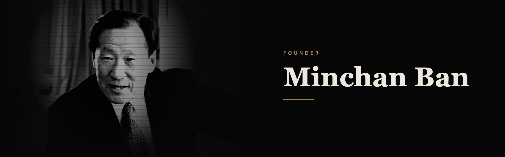

**Founder building Viewchive, and systems that run real work with Claude Code.**

## Now

- **CEO, Trinity**: Building Viewchive, a beauty creator commerce platform that finds the cosmetics shown in Reels.

## Experience

- **Product Manager, Willog** (Jan–Apr 2025): My proposal for a digital cargo insurance business was launched as Willog Insurance. Built the go-to-market strategy from target market research and sales meeting analysis, and created a sales database with key contacts for the sales team.
- **President, [KULSOM](https://kulsom.org/)** (Jul–Dec 2024; member from Mar 2024), Korea University's operations management society: Pitched 50 companies and won 5 industry-academia projects in one semester, the most in the society's history.
- **Production Worker, Food Factory** (Mar 2022–Feb 2024): Forecast holiday demand and built stock in advance, saving about KRW 15 million in labor costs.
- **Founder, KU GREEN** (Nov 2021–Jun 2022): Ran a tumbler mileage program with 8 campus cafés and reached 201 users.
- **[Goal Achievement Scholar, Megastudy](https://www.megastudy.net/campaign/2019_goal/main5.asp?idx=457&Gisu=17#brd_view.asp?target_nm=top&vidx=457&vGisu=17)** (Mar 2021–Feb 2022): Wrote 10 columns on study methods with 300,000 total views.

## Industry-Academia Projects at KULSOM

- **Willog** (2024): Digital cargo insurance business to raise customer conversion, launched as Willog Insurance.
- **POSCO eNtoB** × MSC (2024): Value chain for unused assets, extending ESG sustainable procurement. The plan was adopted.
- **Fresheasy** (2024): Demand forecasting system for refrigerated meal kits.
- **Delivery Lab** × MSC (2024): Expansion into logistics through micro-fulfillment centers, centered on secondhand trading between restaurants. Excellence Award.
- **LG Energy Solution** (2025): My company analysis of LG Energy Solution impressed the company and led to its partnership with KULSOM, opening an industry-academia project for junior members.

## Education

- **Korea University**: Integrated Energy Engineering, double major in Business Administration (on leave)

## Awards

- Grand Prize (KOTRA President's Award), [2024 KSMS Student Competition](https://biz.korea.ac.kr/news/news_view.html?no=3857&g=n)
- Grand Prize, [2024 KU X Cambridge Campus Sharing Economy Makerthon](https://www.veritas-a.com/news/articleView.html?idxno=491399)
- 1st Place, [Korea S&OP Competition](https://biz.korea.ac.kr/news/news_view.html?no=4072&g=n)
- 5th of 143 teams and finalist, representing Korea, [Global Student Challenge](https://biz.korea.ac.kr/news/news_view.html?no=4072&g=n)
- Excellence Award, KULSOM X MSC Delivery Lab Project
- Encouragement Award (KOPOMS President's Award), 2024 Korea Midland Power Student AI Idea Competition: Proposed a site safety system using Edge AI and IoT. As of 2026, Korea Midland Power runs an AI CCTV safety platform with a similar approach.
- Excellence Award, 2021 Sejong Smart Makerthon
- Grand Prize (KOFAC Chairperson's Award), [2017 POSTECH Makers Competition](https://www.facebook.com/share/p/1FhdH8iesw/): Built Phone Stopper, a device to prevent smartphone addiction.

## Projects

- **[bmc-ppt](https://github.com/minchan-ban/bmc-ppt)**: A Claude Code system that builds consulting-style decks and exports them as editable PPTX, PDF, and Figma files
- **[claude-banner](https://github.com/minchan-ban/claude-banner-for-mcban-fans)**: A Claude Code startup banner that renders your photo as pixel art when you run `claude`
- And countless secret projects 😎

## Stack

